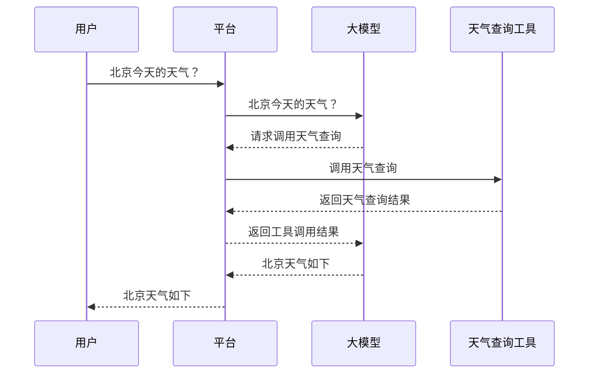

# AI初期的这几年

# AI核心概念串讲

## 一、底层引擎：LLM（Large Language Model）

&emsp;&emsp;LLM全称“Large Language Model”，中文翻译为“大语言模型”，简称“大模型”。基本上现在所有的大模型都是基于Transformer这个架构训练出来的，这个架构最早是由Google团队在2017年提出，对应论文名是“Attention Is All You Need”。虽然Google提出了这个概念，但真正把这个概念引爆的是OpenAI，2022年底GPT-3.5横空出世，是第一个真正达到可用级别的大模型。2023年3月份GPT-4发布，把AI能力的天花板拉到了新的高度。之后随着Claude、Gemini等大模型涌现，现在市场上有多个模型在竞争。

&emsp;&emsp;AI的工作方式本质上就是一个文字接龙游戏。举个例子，我对AI提问“这个文档写的怎么样”，大模型收到这句话后，会在内部进行一系列运算，然后预测下一个出现概率最高的词，比如“特别”，然后吐出这个词；但模型不会停下来，而是把刚刚吐出的“特别”这个词抓回来，和刚刚的输入“这个文档写的怎么样”拼接起来，成为一个新的输入，然后大模型继续预测下一个出现概率最高的词，比如“得”；大模型重复操作，把“得”再次拼接起来成为新的输入后预测下一个词，比如“好”；如果大模型发现这句话已经说完了，那么大模型会再吐出一个结束标识符，这个回答就彻底结束了。

&emsp;&emsp;这就是大模型底层的生成原理，我们看到大模型的输出，就是一个词一个词的输出。

## 二、数据处理单元：Token

&emsp;&emsp;上文中说的大模型每次回答吐出一个词是个方便理解的简化说法，现实情况是：大模型本质上是个庞大的数学函数，里面跑的全是矩阵运算，接收的是数字，输出的也是数字，并不认识人类的文字。所以就像各种编程语言一样，人类和大模型之间也必须有一个翻译官，这个翻译官就叫Tokenizer，他负责的是编码和解码两件事，编码就是把文字变成数字，解码就是把数字变成文字。

&emsp;&emsp;还是用之前的例子，我们给AI输出“这个文档写的怎么样”，AI输出“特别得好”，实际发生的流程如下：

1. Tokenizer对输入的文字进行编码，把文字变数字，这个步骤分两步：
   1. 切分：把输入切成一个一个的片段，如“这个”、“文档”、“写的”、“怎么样”，这些片段就叫做**Token**；
   2. 映射：大模型只认识数字，Tokenizer会把每一个Token对应到一个数字上；这个数字就叫做**Token ID**,Token ID和Token是一一对应的，本质上是一个意思，只不过表达方式不一样，一个是文字，一个是数字;
2. Tokenizer把生成的Token ID组成列表，送入大模型；
3. 模型经过运算，吐出一个Token ID;
4. 解码：Tokenizer把这个Token ID翻译回Token。解码环节不会进行切分，因为大模型一次只吐出一个Token;
5. 如果话还没说完，大模型持续吐出Token，然后Tokenizer进行解码，直到终止符。

&emsp;&emsp;所以**`Token就是大模型处理文本的最基本单位`**。

&emsp;&emsp;上述的例子也只是方便理解，实际上Token和词并不是一一对应的关系，OpenAI提供了一个[把文本转化为Token](https://platform.openai.com/tokenizer)的页面，我们可以在这里看看一句话是怎么拆分成Token的：

|语言单位|于Token的关系|示例|
|:--|:--|:--:|
|中文词语|非一一对应关系，可能被拆分|程序员->"程序"、“员”|
|简单英文单词|常见简单单词会对应一个Token|hello|
|复杂英文单词|可能被拆分|helpful->"help"、"ful"|
|特殊字符|一个字符可能被多个Token表示||

&emsp;&emsp;所以我们不能把词和Token理解为纯粹的一对一关系，可以把Token理解为大模型自己的一套文本切分规则，切出的每一块就是大模型能处理的一个最小单位。平均来讲，一个Token对应0.75个英文单词或1.5~2个中文汉字，量化的看，40万Token就对应60万至80万的汉字或30万英文单词。

## 三、临时记忆体：Context

&emsp;&emsp;大模型本质上就是数学函数，给祂一个输入就给我们一个输出，并不像人一样有记忆。所以我们每次给大模型发消息的时候，并不只发送我们的问题，背后的程序会把之前对话的整段历史找出来一起发出去，这样大模型每次看到的就是完整的对话内容了。

&emsp;&emsp;这就引出了context这个概念，中文叫“上下文”。**`Context代表大模型每次处理任务时所接收到的信息总和`**。Context的内容除包括：对话历史、用户问题、当前输出的Token、工具列表、System Prompt等内容。

&emsp;&emsp;那么一个Context到底能装多大，这就引出了**`Context Window的概念，中文叫“上下文窗口”，代表Context能容纳的最大Token数量`**。Context Window为1万，就代表模型最多能处理1万个Token，目前主流的大模型的Context Window大小都在100万以上，大概有150万汉字，整个哈利波特全集都可以装下。

&emsp;&emsp;虽然当前主流的大模型Context Window都很大，但我们也不可能把全部东西都丢给大模型。设想一个场景：假如我们有一个上千页的产品手册，希望大模型根据这个产品手册来回答用户的各种问题。如果我们把这个产品手册和用户问题一起丢给大模型，显然不是合理的方法，产品手册太长了，即使Context Window足够大，我们的成本也无法控制。所以就需要一个叫**RAG**的技术了，中文叫“检索增强生成”，它可以从产品手册中抽取用户问题最为匹配的几个片段，然后只把这几个片段丢给大模型，让大模型只根据这几个片段回答问题。有了这个技术，就不受大模型的Context Window的大小限制了，成本也会低很多。

## 四、指令交互：Prompt

&emsp;&emsp;**`Prompt，中文叫提示词，是大模型接收的具体问题或指令`**。比如向大模型提需求“帮我翻译这句话”，这就是一个Prompt。

&emsp;&emsp;Prompt怎么写直接决定了大模型的输出质量。假如你只给大模型说“帮我翻译这句话”，那么大模型可能翻译为英文、法文或各种奇妙语言。一个好的Prompt应该是清晰的、明确的。有个专门的领域叫Prompt Engineering，中文翻译“提示词工程”，专门研究怎么把话说清楚，让大模型更精准的理解意图。但这个领域已经没啥人再提了，因为这个领域本质就是把话说清楚，门槛太低，且大模型能力越来越强，即使指令含混不清，大模型也能大概猜出意思。

&emsp;

&emsp;&emsp;有些时候我们不仅要给大模型具体的任务，也要告诉大模型人设和具体做事规则，这就引出了两种Prompt：

+ User Prompt：用户提示词，用于说明具体的任务，是用户自己输入的；
+ System Prompt：系统提示词，用于说明人设和规则，是开发者在后台配置的；

&emsp;&emsp;举个例子：有一个数学辅导机器人，我们希望他不要直接告诉学生答案，要引导学生思考。System Prompt就可以这样设置：“你是一个耐心的数学老师，当学生问你问题的时候不要直接给出答案，而是一步一步引导学生思考，帮助他们理解思路”。这个是开发者在后台设置的，用户看不到，但它会一直影响大模型的行为。这样当用户在对话框输入User Prompt "3+5等于几"的时候，大模型就不会直接回答“8”，而是教学生怎么计算。

## 五、外部能力扩展：Tool

&emsp;&emsp;大模型本质上就是个文字接龙游戏，它的能力是根据训练数据来预测下一个词。但如果我们问大模型“今天北京天气如何”，大模型根部就无法获取当日天气内容，这就需要Tool来解决了。

&emsp;&emsp;**Tool本质上就是函数，我们给它输入，它就返回一个输出**。比如说天气查询的Tool，我们给它城市和日期的输入，它内部一通操作，返回给我们天气数据。**Tool通过提供各种外部能力，让大模型能够感知和影响外部环境**。

&emsp;&emsp;以问天气为例子，总结一下出从用户提问，到大模型输出这样一个完整的工作流是怎么运行的。

&emsp;&emsp;整个流程涉及四个角色：

|角色|职责|
|:--|:--|
|用户|输入指令|
|大模型|选择工具并输出工具需要的参数、对工具返回的结果做归纳总结|
|工具|提供外部能力|
|平台|串联整个流程|

1. 用户提出问题->平台把用户的问题和当前可用的工具列表传递给大模型；
2. 大模型收到问题后分析，如果遇到自己无法解决的能力，会看当前工具列表是否有可用工具；
3. 大模型输出调用某个工具的指令；
4. 平台收到指令，调用工具；
5. 工具返回结果给平台；
6. 平台把信息反馈给大模型；
7. 大模型输出最终结果给平台；
8. 平台把结果转发给用户；

&emsp;&emsp;一定要注意，模型能做的仅仅是接收和输出文本，并不具备其他能力。调用工具、串联上下文这个活是平台来干的。